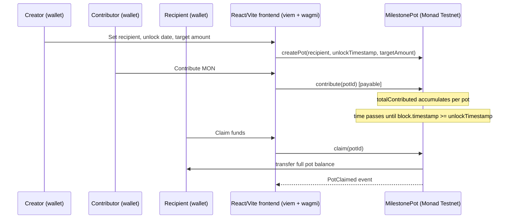

# Milestone-Pot

A simple group gift pot. A creator opens a pot for a recipient with an unlock date, friends contribute funds, and the recipient can claim the funds only after the unlock date — enforced on-chain on **Monad Testnet**.

**Live app:** https://milestone-pot.pages.dev

## Stack

- **Frontend**: Vite + React + TypeScript (`web/`)
- **Chain client**: [viem](https://viem.sh)
- **Contracts**: Solidity 0.8.31 + Hardhat 3 (`contracts/`), deployed with Hardhat Ignition
- **Network**: Monad Testnet (chain id `10143`)

## Project layout

```
contracts/            Hardhat 3 project
  contracts/           MilestonePot.sol — the group gift pot contract
  ignition/modules/    Hardhat Ignition deployment module for MilestonePot
  test/                16 Hardhat/viem tests covering create/contribute/claim
                       and every revert path (access control, timing, double-claim)
  hardhat.config.ts
  .env.example

web/                  Vite + React + TypeScript frontend
  src/
    components/        Pot creation, contribution, and claim UI
    hooks/              wagmi transaction hooks (create, contribute, claim)
    lib/                Contract ABI/address, chain config, wallet setup
  wrangler.jsonc        Cloudflare Pages (Wrangler) deploy config
  .env.example
```

## Prerequisites

- Node.js 22+ and npm
- A funded Monad Testnet account (private key) for deploying contracts — get testnet MON from the official faucet

## Setup

### 1. Contracts (`contracts/`)

```bash
cd contracts
npm install
cp .env.example .env
# edit .env and set PRIVATE_KEY to your Monad Testnet deployer private key
npx hardhat compile
```

Deploy to Monad Testnet:

```bash
npm run deploy:testnet
```

### 2. Frontend (`web/`)

```bash
cd web
npm install
cp .env.example .env
# edit .env: set VITE_MILESTONE_POT_CONTRACT_ADDRESS after deployment, and
# VITE_REOWN_PROJECT_ID (free at https://dashboard.reown.com) — without the
# latter, wallet connection is disabled and the app shows a setup notice
npm run dev
```

## Deployment

The frontend is a static Vite build, deployed to **Cloudflare Pages** via Wrangler (direct upload, not Git-connected):

```bash
cd web
npm run deploy
```

This runs `npm run build` and then `wrangler pages deploy` against the `milestone-pot` Cloudflare Pages project. Requires a local Cloudflare login (`npx wrangler login`) and a correctly configured `web/.env` (see `.env.example`) — the `VITE_*` values are inlined into the build at build time.

Live at: **https://milestone-pot.pages.dev**

## Network reference

| | |
|---|---|
| Chain ID | `10143` |
| RPC URL | `https://testnet-rpc.monad.xyz` |
| Explorer | `https://testnet.monadscan.com` |
| Native currency | MON |

Source: [docs.monad.xyz](https://docs.monad.xyz)

## Deployed on Monad Testnet

- **Network**: Monad Testnet — Chain ID `10143`, RPC `https://testnet-rpc.monad.xyz`, explorer `https://testnet.monadscan.com`
- **Contract address**: [`0x0de99f93f97aeED41C8905416414D90627c15F4D`](https://testnet.monadscan.com/address/0x0de99f93f97aeED41C8905416414D90627c15F4D)
- **Example transactions**:
  - Contract deployment: [`0xbd63ba1ec704df29ba29019704353cc6abe780e5467dfcc3dd79d4a75c7b3d69`](https://testnet.monadscan.com/tx/0xbd63ba1ec704df29ba29019704353cc6abe780e5467dfcc3dd79d4a75c7b3d69)
  - `createPot`: _TBD — to be added before submission_
  - `contribute`: _TBD — to be added before submission_
  - `claim`: _TBD — to be added before submission_
- **Live app**: https://milestone-pot.pages.dev
- **Demo video** (≤3 min): https://youtu.be/s78gnvC9tlg?si=Er5e9r6762_xXBVm

## Why Monad

Milestone Pot's on-chain logic is intentionally simple — a few storage writes and native MON transfers per `createPot`/`contribute`/`claim` call — which is exactly where Monad's low gas fees matter: a group of friends contributing small amounts to the same pot shouldn't each pay outsized fees for a basic transfer. Monad's fast finality means a contribution or claim confirms quickly enough to demo live without awkward waiting, which matters for a flow that's inherently synchronous (recipient claims right after the unlock date). And because Monad is EVM-compatible, the contract is plain Solidity 0.8.31 and the frontend talks to it with viem/wagmi exactly as it would on any EVM chain — no custom chain-specific tooling was needed to ship this.

## Architecture Overview

The app has exactly one on-chain actor (the `MilestonePot` contract) and three user roles that all go through the same React/Vite frontend using a connected wallet (via Reown AppKit/wagmi) and viem to read and write contract state:



This mirrors `MilestonePot.sol` exactly: `createPot` optionally accepts an initial contribution via `msg.value`; `contribute` is open to anyone and reverts if the pot doesn't exist or is already claimed; `claim` reverts unless the caller is the exact recipient and the unlock timestamp has passed, marks the pot claimed before transferring (checks-effects-interactions), and sends the full accumulated balance in one transfer.

## Tech Stack

**Frontend** (`web/`)
- [Vite](https://vite.dev) — MIT
- [React](https://react.dev) 19 — MIT
- TypeScript — Apache-2.0
- [viem](https://viem.sh) — MIT
- [wagmi](https://wagmi.sh) — MIT
- [Reown AppKit](https://docs.reown.com/appkit/overview) (`@reown/appkit`, `@reown/appkit-adapter-wagmi`) — Reown Community License Agreement (not OSI-approved; see the package's own `LICENSE.md`)
- [TanStack Query](https://tanstack.com/query) — MIT

**Contracts** (`contracts/`)
- Solidity `0.8.31`
- [Hardhat](https://hardhat.org) 3 — MIT
- [Hardhat Ignition](https://hardhat.org/ignition) — MIT
- [@nomicfoundation/hardhat-toolbox-viem](https://hardhat.org) — MIT
- [dotenv](https://github.com/motdotla/dotenv) — BSD-2-Clause

**Deployment**
- [Cloudflare Pages](https://pages.cloudflare.com) via the [Wrangler](https://developers.cloudflare.com/workers/wrangler/) CLI

## Hackathon Disclosure

- Built during the Monad Metropolis Hackathon period (Sept 1 – Oct 13, 2026). No pre-existing code was used as a foundation — the contract, frontend, and deployment tooling were all written during the hackathon window.
- **AI tools used**: Claude (Anthropic), via Claude Code — used throughout for Solidity contract design and review, bug fixes (including a stale on-chain data refresh bug in the contribution flow), implementing the recipient claim flow end-to-end, the Vercel-to-Cloudflare Pages deployment migration, and this documentation.
- External libraries and frameworks are listed under [Tech Stack](#tech-stack), with licenses linked where practical.

## Hackathon Track

**Consumer Products & Payments**

## License

MIT — see [LICENSE](./LICENSE).

## Status

Deployed and working on Monad Testnet: contract live, frontend live on Cloudflare Pages, full create → contribute → claim flow functional.
